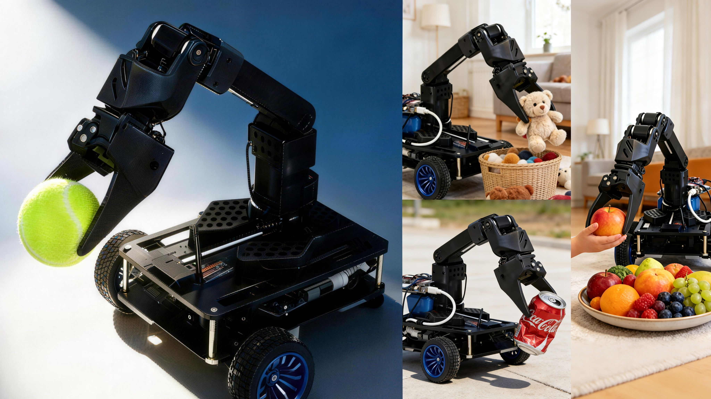
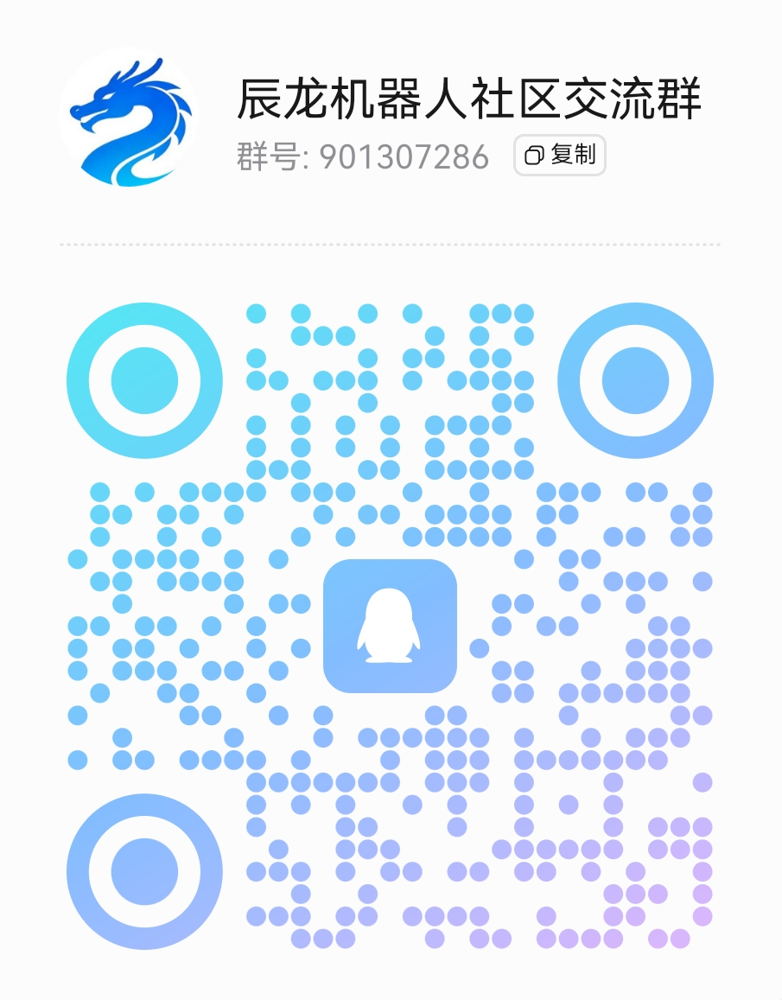

# AKA-00

🤖 全开源辰龙AI教育机器人，降低具身智能学习门槛！



视频：[B站辰龙机器人捡球视频](https://www.bilibili.com/video/BVxxx)

## 📰 新闻

- **2026.4.2**：[299元的辰龙AI教育机器人杀进社区，具身智能的"平民化拐点"已至](https://mp.weixin.qq.com/s/j8OQqoJPdnPGpCfcy5K-Qg)
- **2026.4.1**：[【北京市政府官网报道】299元"手搓"机器人！海淀这家企业，带中小学生玩AI](https://www.beijing.gov.cn/fuwu/lqfw/gggs/202604/t20260401_4572025.html)
- **2026.3.31**：[2026"AI原点杯"全国高校机器人网球抓取大赛报名启动](https://mp.weixin.qq.com/s/bmG5Za7K19GzOHPdTd6O1A)
- **2026.3.23**：[299元，AI原点社区"手搓"机器人将走进千家万户](https://mp.weixin.qq.com/s/oqU5rqGByOrXw3BGT0NAXg)
- **2026.3.17**：["手搓"一个机器人，需要几步？这是辰龙AI机器人在北京AI原点社区的答案](https://mp.weixin.qq.com/s/NPAx-GOC3DAy6-46ltMbig)
- **2026.3.11**：["手搓经济"火了！在京张遗址公园AI创新带，创新可以这么接地气](https://mp.weixin.qq.com/s/1OS5v4nLBUfu4w5yW0DWmQ)
- **2026.3.10**：[【北京时间】"手搓"机械臂 小成本撬动大创新](https://m.btime.com/item/45f615ca83dc8bc19b6578d93be)
- **2026.2.28**：[2026"新春第一会"成功召开！北京AI原点社区重磅签约海淀区"1+X+1"现代化产业体系建设布局！](https://mp.weixin.qq.com/s/43tqfgR5vWyXNMvIIJGpRw)
- **2026.2.6**：[【央视新闻】"十五五"开好局起好步 "创新生态"内如何"长出"产业链？](https://content-static.cctvnews.cctv.com/snow-book/video.html?item_id=3222772778021294082&t=1770334881318&toc_style_id=video_default&share_to=wechat&track_id=69617c7b-a6ff-4ff8-a7ec-bcfffbed544c)

## 🙌 关于我们

从2024年的初步构想，到2025年依托开源机械臂项目实现技术突破，再到2025年底提出概念：让人手一台机器人成为可能！这一路，有不少优秀的伙伴参与进来，和我们一起把机器人硬件做的更加低成本，共同把这个开源项目做得更好！

终于在2026年初，299元辰龙AI教育机器人正式落地！它能完成"识别网球位置—自主移动—完成捡球动作"的视觉-运动-执行完整闭环。软硬件开源，使得学习者可以进行二次开发改造，降低具身智能的学习门槛。辰龙机器人是一个面向教学的低成本AI机器人，通过提供简单的平台实现多种算法的训练和仿真。

## 💬 交流社区

 

QQ群：901307286

## 📖 文档

[辰龙AI教育机器人技术文档](./docs/src/README.md)

## 💰 总成本

299¥ 即可购买辰龙AI教育机器人组件套装，微信小店购买：[链接]

## 🚀 快速开始

1. 💰 购买硬件：[购买链接]
2. 🔨 组装：[组装文档/视频链接]
3. 💻 软件课程，请报名训练营学习：[训练营课程链接]

## 📦 打包

`cpp/` 是整个软件的实体：交叉编译成 riscv64 静态二进制 `aka-capp`（无任何运行时依赖），
再把配置、前端页面、demo 一起收成**一个自解压安装器**，拷到板子上就能装。

```bash
cd cpp
make              # 一条龙：libjpeg/mbedtls/lua → csrc → capp → package → ota
make screen       # 只出部署目录（= package）
make ota          # 只出安装器（内部先 package）
make noscreen     # 不带屏版本：dist-noscreen/
make clean        # 清理全部构建产物
```

产物两样：

| 产物 | 说明 |
|---|---|
| `cpp/dist/AKA-00/` | 部署目录，解包后就是板上的 `$AKA_HOME` |
| `cpp/dist/aka-00-server` | 自解压安装器（约 20MB），首次部署与 OTA 升级共用同一个文件 |

**构建环境**：交叉编译需要 riscv64-unknown-linux-musl 工具链。在 orb（Linux）里直接
`make`；在 macOS 上 `make` 会自动经 `orb run` 转发交叉编译，产物落在共享目录，两边路径一致。

**前端不参与 make**：`make package` 直接拿仓库根 `static/` 里已构建好的前端产物打包，
所以**改了前端要自己先 build**，而且版本要和包对上（拿错版本打包脚本会告警）：

```bash
cd frontend && npm run build            # 带屏版 → static/
cd frontend && npm run build:noscreen   # 不带屏版 → static/
```

**实验页面资源**单独维护在仓库根 `static-assets/experiments/`（5 个实验的构建产物，
含模型，约 35MB），`make package` / `make ota` 会自动合并到
`$DIST/static/assets/experiments/`。不能直接放 `static/`：那是 vite 的 outDir 且
`emptyOutDir: true`，每次前端构建都会清空。更新实验页面时用 car-ai-senses 的
`build-all-robot` 重新构建，按部署清单（去掉原模型二进制/`.js` 别名/`.gz`）同步这个目录。

**带屏 / 不带屏**：编译期开关（后端 `AKA_WITH_SCREEN`、前端 `WITH_SCREEN`），
构建目录与产物完全隔离、互不覆盖。

| | 带屏版（默认） | 不带屏版 |
|---|---|---|
| 构建 | `make` | `make noscreen` |
| 产物目录 | `cpp/dist/` | `cpp/dist-noscreen/` |
| 区别 | 摄像头画面实时显示到板载 SPI 屏（`/dev/fb0`） | 整个显示栈编译期裁掉，二进制更小，完全不碰 framebuffer |

两份包**除编译产物（ELF + 前端 bundle）外完全一致**：文件集合、权限、`config.toml`／
`*.sh`／`demo/*.lua` 等文本文件逐字节相同；板上的二进制名都叫 `aka-capp`。

> 板上要哪些文件由**实体文件**说了算：`cpp/board/` 就是板上 `$AKA_HOME/` 的镜像。
> 想改 `config.toml`、`init.sh`、demo 脚本，直接改那里的实体文件，不用碰构建脚本。

## 🚀 部署

目标板 SG2002（LicheeRV Nano）。安装器把包解开到 `$AKA_HOME`（默认 `/root/AKA-00`）。

### 首次部署

```bash
# 1. 拷到板子（scp 加 -O：板载 sshd 不认新版 SFTP 协议）
scp -O cpp/dist/aka-00-server root@<板子IP>:/root/

# 2. 首次初始化：解包 + 配热点 + 开机自启 + 立即启动
ssh root@<板子IP> '/root/aka-00-server --init'
```

`--init` 会自动完成：
- 解包到 `$AKA_HOME`（默认 `/root/AKA-00`）
- 配置 AP 热点（SSID 基于 MAC 地址唯一生成）、DHCP，写入 `S98apstart` / `S99webstart` 自启脚本
- 立即启动热点

> ⚠️ 别把固件放 `/tmp`：板上 `/tmp` 是 53MB 的**内存盘**，20MB 的固件放那儿会把内存打爆
> （实测 OOM 掉 `aka-capp`）。拷到 `/root/` 下。

### 更新部署（升级）

```bash
scp -O cpp/dist/aka-00-server root@<板子IP>:/root/
ssh root@<板子IP> 'setsid /root/aka-00-server --update >/root/ota.log 2>&1 < /dev/null'
```

换包流程：停服务（`aka-capp` + 守护脚本 `init.sh`）→ 解到 `$AKA_HOME.new` → 保留现场数据 →
目录改名换入（旧目录留成 `$AKA_HOME.old` 作回滚点）→ 重新拉起。

- **`--update` 默认保留板上这些文件**（整目录替换，不在名单里的一律会没）：
  `config.toml`、`speed_config.json`、`arm_angles.json`、`cert.pem`、`key.pem`；
  `demo/configs/`（用户建的卡片）**板上优先**，`demo/models/`（用户传的模型）按文件名取并集。
- **想让包里带的新配置生效**（比如改了 `[display] scale`）：
  `ssh root@<板子IP> 'AKA_OTA_RESET_CONFIG=1 /root/aka-00-server --update'`，或部署后手改 `config.toml`。
- 换包中途失败不影响现场：包自检不过（缺 `config.toml`）会中止并留老版本继续跑，回滚点 `$AKA_HOME.old`。
- `--update` 最后是 `exec init.sh`，服务挂在这条 ssh 会话上 —— 所以要 `setsid` 起，
  或者升级完 `reboot`（开机由 `S99webstart` 拉起）。

其它用法：

```bash
/root/aka-00-server --extract                         # 只解包到 $AKA_HOME，不重启
AKA_HOME=/tmp/x ./cpp/dist/aka-00-server --extract    # 先在开发机上验证包内容
```

### 方式 B：整目录拷贝

```bash
scp -O -r cpp/dist/AKA-00 root@<板子IP>:/root/AKA-00
ssh root@<板子IP> '/root/AKA-00/init.sh'
```

> `scp -r` 不保留可执行位，`init.sh` 启动前会兜底 `chmod +x`。优先用方式 A 的安装器
> （自带权限位，且有 `.old` 回滚点）。

### 在线 OTA

板子联网后可以直接在网页上升级：前端「检查更新」→ `GET /api/ota/check` 去请求
`config.toml` 里 `[ota] check_url` 配的版本接口（默认官方版本服务）→ 有新版点「立即升级」，
capp 下载固件后 `exec <固件> --update`，走的就是上面同一套换包流程。

### 热点信息

- SSID: `chenlong-robot-xxxxx`（基于设备 MAC 地址生成）
- 网关: `192.168.4.1`
- 连接热点后浏览器访问 `http://192.168.4.1` 即可控制（HTTPS `https://192.168.4.1`，自签证书）

## 目前功能

### ✅ 已完成

| 功能 | 说明 |
|------|------|
| 机械臂控制 | 控制机械臂完成抓取和释放动作 |
| 底盘运动 | TT 马达差速控制（ESP32-C3 底盘板闭环），支持前进/后退/转向 |
| Web API | 提供 HTTP 接口远程控制机器人 |
| Web 界面 | React 前端，可远程控制机器人运动和夹爪 |

## 代码结构

板上跑的一切都在 `cpp/` 里；根目录其余部分是 Python 版（历史实现）的遗留文件，不再维护。

```
AKA-00/
├── cpp/                    # 当前实现：编译成单个 riscv64 静态二进制
│   ├── capp/               #   aka-capp 服务进程：HTTP/WS 服务 + 各接口路由
│   ├── csrc/               #   平台与硬件层：摄像头、板载屏、串口、舵机、电机、推理
│   ├── board/              #   板上 $AKA_HOME/ 的镜像（config.toml、init.sh、demo/…）
│   ├── scripts/            #   第三方库构建 + 自解压安装器打包脚本
│   └── third_party/        #   libjpeg / mbedTLS / Lua（交叉编译产物）
├── frontend/               # React 前端源码
├── static/                 # 前端构建产物，打包时收进部署目录
├── tests/                  # 板测工具（demo_camera / demo_image / bench_*）与测试脚本
├── hardware/               # 硬件资料（原理图、舵机手册）
├── docs/                   # 文档（mdBook）
│
├── run.py / app/ / src/ / templates/   # 以下都是 Python 版遗留，板上不使用
└── build_release.sh        # （打包请走 make -C cpp ota）
```

各模块职责、板上文件从哪来、改动该改哪里，见 [cpp/README.md](./cpp/README.md)。

## 技术栈

### 设备端（`cpp/`）

| 技术 | 用途 |
|------|------|
| C++17 | 核心语言，静态编译到 riscv64-musl，单文件无运行时依赖 |
| 自研 HTTP / WebSocket | POSIX socket + 线程，不引第三方 Web 框架 |
| mbedTLS | HTTPS 监听与 TLS 终止 |
| Lua 5.4 | demo 流程脚本宿主：原语在 C++，流程在脚本 |
| libjpeg / V4L2 | 摄像头采集与 JPEG 解码 |
| 算能 NPU | `.cvimodel` 模型推理（1 TOPS INT8） |

### 前端（`frontend/`）

| 技术 | 用途 |
|------|------|
| React 19 | UI 框架 |
| TypeScript 5.9 | 类型安全 |
| Vite 8 | 构建工具 |
| React Router 7 / Zustand | 路由 / 状态管理 |

## 环境变量

配置主要在 `$AKA_HOME/config.toml`（端口、串口、摄像头、屏…），环境变量用于**覆盖**
其中的对应项，平时不用设：

| 变量名 | 默认值 | 说明 |
|--------|--------|------|
| `AKA_HOME` | `$HOME/AKA-00`（板上 `/root/AKA-00`） | 部署目录；`static/`、`config.toml`、demo 都从这里找 |
| `AKA_SERVER_NAME` | `aka-capp` | OTA 重启脚本里用的进程名 |
| `ARM_ANGLES_PATH` | `$AKA_HOME/arm_angles.json` | 机械臂角度文件路径 |
| `OTA_CHECK_URL` | `config.toml` 的 `[ota] check_url` | 检查更新的版本接口 |
| `STATUS_REPORT_URL` | `https://api.chenlongrobot.com/api/robot-actions` | 状态上报地址（留空则不上报） |
| `STATUS_REPORT_INTERVAL` | `300` | 状态上报间隔（秒） |
| `AKA_WIFI_CONF` | `/etc/aka-wifi.json` | WiFi 凭据文件；本机调试时改指向，避免动开发机的 `/etc` |

> Python 时代的 `APP_HTTP_PORT` / `APP_HTTPS_PORT` / `APP_CERT_PATH` / `APP_KEY_PATH`
> **已废弃**：端口改在 `config.toml` 的 `[web] port` / `https_port`，证书固定读
> `$AKA_HOME/cert.pem` / `key.pem`（缺了由 `init.sh` 自动生成）。

## API 接口

机器人自带 Web 服务：接口都开在板子 IP 上（连热点时是 `http://192.168.4.1`，
HTTPS `https://192.168.4.1`），**无需鉴权**，默认返回 JSON。前端的 `frontend/src/api.ts`
与本表逐条对齐；每个接口的完整参数、错误码与示例见 [API 文档](./docs/src/05-usage/api.md)。

### 接口总览

| 分组 | 接口 |
|---|---|
| 动作控制 | `GET /api/control` |
| 电机 | `GET /api/motor/status`、`GET /api/motor/direct`、`GET /api/motor/raw_command` |
| 机械臂 | `GET/POST /api/arm/angles`、`GET/POST /api/arm/angles/default`、`POST /api/arm/angles/preview` |
| 摄像头 | `GET /api/camera/status`、`POST /api/camera/open`、`POST /api/camera/close`、`GET /api/camera/snapshot`、`GET /api/camera/stream`、`GET /api/camera/speed`、`GET /api/camera/all_status` |
| 单帧推理 | `GET /api/detect?model=` |
| 模型管理 | `POST /api/models/upload?name=`、`POST /api/models/delete`、`POST /api/model/upload`（训练平台契约） |
| Demo | `GET /api/demo/list`、`POST /api/demo/init`（或 `/run`）、`GET /api/demo/status`、`POST /api/demo/stop`、`GET/POST /api/demo/config`、`POST /api/demo/delete`、`GET /api/demo/name` |
| 速度配置 | `GET/POST /api/config/speed` |
| 左右方向切换 | `GET/POST /api/config/motor`（电机接线标定，落 `motor_config.json`） |
| WiFi | `GET /api/wifi/scan`、`POST /api/wifi/connect`、`GET /api/wifi/status`、`GET /api/wifi/ip` |
| OTA | `GET /api/ota/version`、`GET /api/ota/check`、`POST /api/ota/upgrade`、`GET /api/ota/status`、`GET /api/ota/upgrade/progress`、`POST /api/ota/update`（直接传固件） |
| 系统 | `GET /api/system/info`、`GET /api/system/ip`、`GET /api/system/heartbeat` |
| 板载屏 | `GET /api/display/status`、`POST /api/display/enabled`（只对带屏版有意义） |
| 实时通道 | `WS /ws/control`（二进制，低延迟摇杆） |
| 页面 | `GET /` 及 `/assets/*`（前端 SPA，未匹配路径回退 index.html） |

> **通用约定**：不用鉴权，JSON 响应都带 `Access-Control-Allow-Origin: *`（可跨域直调）；
> 请求体上限 32MB；`GET /` 之外的 `/api/*` 未匹配路径返回 `404`，其余未匹配路径回退
> `index.html`。错误响应目前有三种形状（`{"error":…}`、`{"status":"error","message":…}`、
> `{"ok":false,"error":…}`），按接口而异 —— 每个接口的确切形状见
> [API 文档](./docs/src/05-usage/api.md)。

### 动作控制

```bash
GET /api/control?action=<action>&speed=<speed>&time=<time>&distance=<distance>&angle=<angle>
```

| 参数 | 类型 | 说明 |
|------|------|------|
| action | string | 动作：`up`, `down`, `left`, `right`, `stop`, `grab`, `release` |
| speed | int | 电机百分比 1~100，默认 50（直接给 ESP32 PID 的 target_rpm） |
| time | int | 持续时间（毫秒），无 distance/angle 时生效 |
| distance | float | 移动距离（厘米），up/down 有效 |
| angle | float | 转动角度（度），left/right 有效 |

> **优先级**：`distance`/`angle` > `time`。`distance` 只对 `up`/`down` 有效、`angle` 只对
> `left`/`right` 有效，配错动作直接返回 `400`（不会静默忽略）。
>
> **返回时机不同**：给 `distance`/`angle` 会**阻塞**到固件闭环报结果（最多 30s），
> 回 `{"completed": true}`（失败多一个 `error`）；给 `time` 阻塞到动作做完并停车；
> 只给 `action=up` 则**立刻返回**，车会一直走，靠 `?action=stop` 停。
> `grab`/`release` 阻塞到动作做完（约 3.5s），且**不排队** —— 上一段没做完时直接回
> `400`，不会攒成一串挨个执行。

```bash
# 前进 1 秒，速度 30%
curl "http://192.168.4.1/api/control?action=up&speed=30&time=1000"

# 左转 90 度（阻塞到转完）
curl "http://192.168.4.1/api/control?action=left&angle=90"

# 抓取 / 释放
curl "http://192.168.4.1/api/control?action=grab"
curl "http://192.168.4.1/api/control?action=release"
```

### 电机

```bash
GET /api/motor/status                              # 当前速度/目标/夹爪状态
GET /api/motor/direct?left=<l>&right=<r>&duration=<秒>   # 直接给左右轮 -100~100
GET /api/motor/raw_command?cmd=<cmd>               # 透传固件原始指令（排障用）
```

### 摄像头

```bash
GET  /api/camera/status          # {"camera_on": true}
POST /api/camera/open            # 打开（打不开返回 500）
POST /api/camera/close           # 关闭
GET  /api/camera/snapshot        # 单张 JPEG，返回 base64 + 距离标定常数 m/c
GET  /api/camera/stream?fps=15   # MJPEG 流，浏览器  直接用
GET  /api/camera/speed           # 底盘/电机状态（历史命名，和摄像头无关）
GET  /api/camera/all_status      # 底盘/电机状态 + image(base64 JPEG, q25) + 电机连接状态
```

> `speed` / `all_status` 是**历史命名**，回的实际是底盘与电机状态。`all_status` 不会打开
> 摄像头：摄像头关着时它回的是内存里缓存的最后一帧，所以要判断实时性只能看 `camera_on`。

> 摄像头**全局唯一一份**：屏显示、浏览器取流、单帧推理共用它。打开/关闭会同步影响板载屏
> （关掉摄像头屏上回到待机图），对前端透明。
>
> `stream` 默认**直通摄像头原始 MJPEG 帧**（服务端零解码零编码），单核 SoC 上这是"网页看
> 摄像头不卡"的关键；只有 `[camera] stream_scale = true` 才会在服务端缩放重编码。

### 单帧推理

```bash
GET /api/detect?model=tennis&conf=0.25&iou=0.45
```

取当前帧跑一次模型，返回检测框的四个角（**原图像素坐标**，与 `snapshot` 同一坐标系）：

```json
{"ok": true, "count": 1, "boxes": [{"x1": 236.0, "y1": 88.5, "x2": 436.0, "y2": 283.5}]}
```

`model` 必填，裸名字映射到 `$AKA_HOME/demo/models/<名字>.cvimodel`；`conf`/`iou` 可选
（默认 0.25 / 0.45）。`count: 0` 是**正常结果**（画面里没目标）。参数给错值会返回 `400`
而不是悄悄用默认值 —— 免得"以为生效了其实没生效"。

### 模型管理

```bash
POST /api/models/upload?name=apple   # body 就是模型文件（同名覆盖、覆盖即生效）
POST /api/models/delete              # {"name":"apple"}
```

上传给训练平台用：把 `.cvimodel` 推进 `demo/models/`，就是 `/api/detect` 唯一认的那个模型库
（上限 32MB）。删除只删文件，用到它的 demo 卡片会变成 `ready=false`，重传同名即复活。

### Demo（动作 × 模型）

板上的一张卡片 = **动作脚本（`demo/*.lua`）× 模型（`demo/models/*.cvimodel`）+ 几个参数**
（`target_size` / `speed` / `turn_speed` / `mode`），一份配置一张卡，存在
`demo/configs/<卡片名>.json`。

```bash
GET  /api/demo/list                              # 卡片列表 + 可用动作 + 可用模型
POST /api/demo/init  {"name":"追网球接近"}         # 跑存下来的那张卡片
POST /api/demo/init  {"action":"grab","model":"tennis"}   # 不建卡，临时组一个直接跑
GET  /api/demo/status                            # 跑到哪了（state/message/round）
POST /api/demo/stop                              # 停
GET  /api/demo/config?name=<卡片名>                # 读卡片参数
POST /api/demo/config                            # 新建或覆盖一张卡片（同名即改参数）
POST /api/demo/delete                            # {"name":"..."}
```

- `init`/`run` **默认等跑完再返回**：`{"completed": true}`；失败回
  `{"completed": false, "error": "..."}`。想立刻返回自己轮询就传 `"wait": false`。
- `mode` 两种：`once`（默认，跑一遍，**最多 5 分钟**）、`loop`（跑完接着跑，**没有时长上限**，
  要停就 `POST /api/demo/stop`；它不会自己结束，所以默认不等，显式 `wait: true` 会被 400 拒掉）。
- 卡片是用户在板上建的**现场数据**，OTA 升级时**板上优先**保留；动作脚本相反按包里的结算
  —— 所以调参要改卡片配置，**别改 `demo/*.lua`**。

### 速度配置 / WiFi / OTA / 系统

```bash
GET/POST /api/config/speed                 # {"forward_speed":50,"turn_speed":50}
GET/POST /api/config/motor                 # {"swap_lr":false} 左右方向切换（接线标定，立即生效）

GET  /api/wifi/scan                        # 扫描附近 WiFi（wlan1）
POST /api/wifi/connect                     # {"ssid":"...","password":"..."}，无密码传空串
GET  /api/wifi/status  |  GET /api/wifi/ip  # 连接状态 / 当前 IP
#   连过的 WiFi 会记到 /etc/aka-wifi.json（0600），开机自动重连；删掉即"忘记网络"

GET  /api/ota/version                      # 当前版本
GET  /api/ota/check                        # 检查更新（请求 config.toml 的 [ota] check_url）
POST /api/ota/upgrade                      # 在线升级（异步），进度看下两个
GET  /api/ota/status  |  GET /api/ota/upgrade/progress?task_id=<id>
POST /api/ota/update                       # 不联网：直接把固件文件 multipart 传上来装

GET  /api/system/info                      # {"ip": ..., "mac": ...}
GET  /api/system/ip                        # {"ip": ...}
GET  /api/system/heartbeat                 # cpu / mem / disk / uptime
```

### WebSocket 实时控制

摇杆这种高频操作用 HTTP 会卡，前端走 WebSocket 二进制通道（**同一时刻只连一个**，
处理循环独占该连接）：

```
ws://192.168.4.1/ws/control          # HTTPS 页面上用 wss://
```

| 方向 | 帧格式 | 说明 |
|---|---|---|
| 客户端 → 服务端 | `0xAA` + int8 `x` + int8 `y` | 摇杆（3 字节）：x 转向、y 油门，各 -128~127；按 `y+x` / `y-x` 除以 127 再映射到左右轮 ±100 |
| 客户端 → 服务端 | `0xDD` + UTF-8 JSON | 低频命令：`{"type":"action","action":"stop","speed":50,"time":0}`、`{"type":"ip"}`、`{"type":"raw_command","cmd":"…"}` |
| 服务端 → 客户端 | `0xBB` + int16LE 左轮 + int16LE 右轮 | 轮速（m/s × 1000），**每 200ms 推一次** |
| 服务端 → 客户端 | `0xDD` + UTF-8 JSON | 状态与应答：`{"type":"motor_status","motor":{…}}` 等 |

```javascript
const ws = new WebSocket("ws://192.168.4.1/ws/control");
ws.binaryType = "arraybuffer";
ws.send(new Uint8Array([0xAA, 0 /*x*/, 50 /*y*/]));   // 前进
ws.send(new Uint8Array([0xAA, 0, 0]));                // 停
```

> ⚠️ **断开连接不会自动停车**（这点与 Python 版相反）：停车的责任在指令本身
> （发 `x=y=0` 或 `{"type":"action","action":"stop"}`），以及 ESP32 固件侧的心跳看门狗。
> 服务端每 4 秒 ping 一次，90 秒收不到任何字节才强制断开连接。

### 静态页面

`GET /` 及 `/assets/*` 返回前端构建产物（打包进 `static/`），未匹配的路径回退到
`index.html`（SPA 路由）。改前端要重新 `npm run build` 后再打包。

## 硬件配件详情

主控：[LicheeRV Nano](https://wiki.sipeed.com/hardware/zh/lichee/RV_Nano/1_intro.html)
（算能 SG2002，1 TOPS INT8 NPU）。

| 部件 | 型号 | 连接 | 配置 |
|------|------|------|------|
| 机械臂舵机 | ZL-ZP10S（也支持 STS3215） | UART `/dev/ttyS2` @115200 | `[arm]`，`backend = "zp10s"` |
| 底盘电机 | TT 马达 ×2（带编码器） | 接 ESP32-C3 底盘板，UART `/dev/ttyS1` @115200 | `[motor]`，`backend = "tt_pid"` |
| 摄像头 | USB UVC（MJPEG 输出） | — | `[camera]`，默认 640x360 @15fps |
| 板载屏 | ST7796S 320x480 RGB565 | SPI | `[display]`（仅带屏版） |

### 底盘：TT 马达 + ESP32-C3 闭环

电机**不直连主控**（主控上没有电机 PWM/GPIO 接线）：由一块 ESP32-C3 底盘板做闭环 PID
（编码器 4680 脉冲/轮圈），主控经串口下发目标转速并读回实际转速与状态，走距离/角度的
闭环也在固件里做。所以 `?speed=` 给的是百分比，换算成 `target_rpm` 后由固件执行 ——
这也是"车被卡住会回 `aborted`/`timeout` 而不是谎报成功"的原因。线速度换算用
`[chassis]` 的轮径 62mm（固件返回的 rpm 已是轮速，不再除齿轮比）。

底盘固件（`esp32_base_control/base_control.ino`）是独立工程，不在本仓库。

> ESP32 上电比主控慢几百毫秒，所以底盘串口**不是服务启动的硬依赖**：连不上会按退避
> 自动重连，ESP32 意外重启也能自愈。

### 机械臂：ZL-ZP10S 串口舵机

`[arm] backend = "zp10s"`。各舵机的标定角度存在 `$AKA_HOME/arm_angles.json`
（夹爪开合、抓取位、抬起位都在里面），路径可用 `ARM_ANGLES_PATH` 覆盖；
页面上的角度标定与 `/api/arm/angles` 读写的是同一份文件。

## 🙏 致谢

[](https://github.com/chenlongos/AKA-00/graphs/contributors)
[](https://github.com/chenlongos/AKA-00/commits/main)

感谢所有为 AKA-00 做出贡献的人！

<!-- ALL-CONTRIBUTORS-LIST:START - Do not remove or modify this section -->
<!-- prettier-ignore-start -->
<!-- markdownlint-disable -->
<table align="center" border="0" cellspacing="10">
  <tr>
    <td align="center"><a href="https://github.com/shzhxh"><br/><b>shzhxh</b></a></td>
    <td align="center"><a href="https://github.com/moyufei-MAX"><br/><b>moyufei-MAX</b></a></td>
    <td align="center"><a href="https://github.com/yydawx"><br/><b>yydawx</b></a></td>
  </tr>
</table>

## 💪 贡献

👋 想要为 AKA-00 做出贡献吗？请参阅 [CONTRIBUTING.md](./CONTRIBUTING.md)，了解如何参与。

## 免责声明
