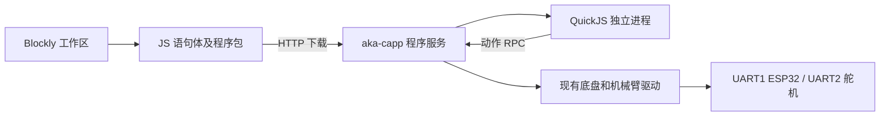

# Blockly 板端独立运行原型

`competition-platform/projects/blockly-page3` 已将积木生成异步 JavaScript。
这里保留该语言和 `await robot.*` 接口，在 SG2002 主控上运行独立 QuickJS 进程。
`aka-capp` 管理程序、运行状态与硬件；JS 进程通过 stdin/stdout 请求动作。
不需要 Node.js、浏览器或 Python。巡线、视觉、模拟器传感器暂不支持。



## 程序包和接口

程序包格式为 JSON，程序是语句体，允许 `await`，不带额外执行包装：

```json
{
  "formatVersion": 1,
  "sdkVersion": 1,
  "name": "示例",
  "program": "await robot.forwardSeconds(0.4); await robot.print('完成');",
  "workspace": {},
  "requiredCapabilities": ["forwardSeconds", "print"],
  "settings": {"moveSpeed": 25, "turnSpeed": 25, "maxRuntimeMs": 30000}
}
```

| 接口 | 请求和用途 |
| --- | --- |
| `GET /api/program/capabilities` | 程序/SDK 版本、大小上限、能力清单及运行器是否存在 |
| `POST /api/program/deploy` | 请求体为程序包；持久保存代码和开机选择，立即启动并返回 `programId`、`runId`、`deployed=true` |
| `POST /api/program/upload` | 请求体为程序包；校验、语法检查通过后替换当前程序，返回内容 SHA-256 `programId` |
| `POST /api/program/run` | `{"programId":"..."}`；立即返回 202 和 `runId`，后台执行 |
| `POST /api/program/stop` | `{"runId":"..."}`；停止该次执行，过期 ID 返回 409 |
| `GET /api/program/status` | 状态、当前积木、耗时、错误、停车确认、机械臂是否仍忙、存储类型 |
| `GET /api/program/logs?runId=...&after=0` | 最多保留 256 条日志，按序号增量读取，`truncated` 标记旧日志已被截断 |

只保留一个程序槽。运行中不能上传覆盖，也不能启动第二个程序；Demo 与程序互斥。
程序开始后不依赖网页心跳或 HTTP 长连接。刷新页面应读状态，不能重试启动请求。
运行标识防止旧页面误停新运行。默认不开机自动运行：重启保留程序，异常中断标为
`interrupted`，由用户明确重新启动。使用 `/deploy` 的程序会在下次整板开机从头执行。显式配置方式见下一节。

## 一键下载并部署

competition-platform 的“真实小车”模式提供“下载并部署”：生成完整 JS、工作区和运行参数，
先校验能力清单，再调用 `/api/program/deploy`。一次请求完成持久保存、开机选择和立即运行；
网页只读状态和日志，刷新、后台或关页都不会停止板端程序。“停止”只停止当前这一次。

板端把服务生成的 `autorunOnBoot=true` 与代码写入同一个 `current.json`，通过原有 fsync、
rename、目录 fsync 一起提交，避免代码与自启设置分成两个写入步骤。普通 `/upload` 会移除此标记，
不会继承部署设置。部署程序优先于下面的手工配置，网页无需修改 `config.toml`。
只允许持久目录部署；运行中、Demo 或机械臂忙、底盘未连接或未静止时拒绝覆盖。
校验失败保留旧程序；已保存但未能立即启动时返回 `deployed=true` 和错误，状态可查询。

部署前登记本次开机标记，服务崩溃重启不会重复执行。下一次整板开机获得新的标记后，
已部署程序从头执行，包括上次断电中断的情况；手工绑定的普通上传程序仍保持中断后人工启动。
请求超时不能自动重试 `/deploy`，应先读 `/status`，防止重复执行。

## 开机自动运行

普通 `/upload` 后也可在板端实际使用的 `config.toml` 加入以下配置，并重启服务使配置生效：

```toml
[blockly]
autorun_enabled = true
autorun_program_id = "这里填写上传接口返回的64位小写 programId"
startup_timeout_ms = 30000
```

该设置绑定完整程序包的 SHA-256；上传不同程序不会自动继承。版本不匹配、运行器缺失、
配置无效或上次运行异常中断时不启动，状态给出原因。默认配置为关闭，关闭后仍可手动运行。

服务监听后在后台等待底盘连接、探活成功和连续三次真实轮速为零，最长等待指定时限。
等待不依赖网络或浏览器，不阻塞 HTTP；正在进行的距离动作或机械臂动作不满足就绪条件。
就绪后复用 `ProgramService::run` 和现有隔离运行器，不另建一套动作执行流程。

启用时先原子创建 `/tmp/aka-blockly-autorun.claim`，再校验和等待。该目录所在的 `/tmp`
必须在整板重启时清空。每次开机只有一次自动尝试：成功、失败、超时、取消
均不重试；守护程序重新拉起服务或 OTA 重启服务不会重复执行，整板重启清除标记。
首次启用且本次开机尚无标记时，重启服务也会触发这次自动尝试。

`GET /api/program/status` 新增 `autorun` 对象：`enabled`、绑定的 `programId`、`state`
和 `message`。状态包括 `disabled`、`waiting`、`started`、`armed`、`skipped`、`cancelled`、`failed`。
`armed` 表示由部署选为后续开机程序。
`started` 表示本次开机已经触发，程序是否完成仍读取外层的 `state`。

等待期间，`POST /api/program/stop` 请求体为 `{}`（此时尚无 runId），可以取消本次开机运行。
开始执行后必须携带当前 runId；旧 runId 不能停止新程序或取消待启动程序。
手动底盘控制（包括停车）、下载程序或手动启动程序会取消待启动的自动运行；
有 Demo 运行时也取消。程序开始后的人工接管和停止沿用现有运动控制权校验。
若希望开机后延时再运动，可在 Blockly 程序开头加入等待积木。

## 执行与停止边界

- JS 进程只暴露动作 RPC 和结束通知；没有模块加载器、文件、进程、网络或 DOM API。
- JS 堆上限 8 MiB、栈上限 512 KiB。最大执行时间由包指定，100～600000 ms；
  父进程和 QuickJS 中断器各自检查，死循环和内存不足会失败退出。
- 上传包上限 512 KiB，JS 上限 128 KiB，单条 RPC 上限 16 KiB。日志条数和单条文本长度均有限制。
- 能力清单用于兼容性预检，硬件 RPC 自身另有方法白名单及参数校验；清单不能授权任意硬件操作。
- 首版速度允许 0～50%。距离用 cm、角度用度，转发 ESP32 时转换为 mm / 0.1°。
  距离和转向等待固件状态，不把前次残留的完成状态当成本次完成；没有新反馈会超时失败。
- 动作启动和停止都检查已有 `motion_seq`。停止设置取消标记后拦住后续动作；
  人工接管使旧程序失败，旧程序清理不刹停新控制者。
- 底盘程序结束/停止会刹车，并用链路探活及连续零速反馈确认。
  停车未确认时拒绝再启动，直到重新读到静止反馈。
- 夹爪启动前读取真实位置确认通信。停止时阻止下一动作，已经受理的标定序列会
  继续收尾，状态保持 `stopping`；目前没有舵机急停。`completed` 表示现有驱动序列
  返回，不代表已抓住物体，也不保证末尾抬臂已精确到位。

## 构建和部署

```sh
make -C cpp blockly                     # 静态 RISC-V 运行器
make -C cpp/blockly                     # 本机运行器
make -C cpp package                     # 带屏包含运行器、SDK、许可证
make -C cpp package-noscreen            # 不带屏包包含相同文件
make -C cpp/capp test-program test-control test-lua  # 主机服务/独立进程/控制边界与 Demo 回归
```

QuickJS 固定为 2026-06-04，首次由 `scripts/build-quickjs.sh` 下载并校验 SHA-256。
下载后构建不需要网络。运行器、SDK 应随服务一起发布：

```text
$AKA_HOME/aka-capp
$AKA_HOME/aka-blockly-runner
$AKA_HOME/blockly/robot-sdk.js
$AKA_HOME/blockly/QUICKJS-LICENSE
$AKA_HOME/programs/current.json
$AKA_HOME/programs/last-run.json
```

默认程序目录为 `$AKA_HOME/programs`，写临时文件、fsync、rename、目录 fsync 后提交。
正常 OTA 保留程序。环境变量 `AKA_PROGRAM_DIR` 和 `AKA_BLOCKLY_RUNNER` 可覆盖路径；
`AKA_PROGRAM_VOLATILE=1` 跳过持久同步，状态明确报告 `storage=volatile`。
主机测试需要系统 mbedTLS 头文件及 `libmbedcrypto`。板端通过仓库已有 mbedTLS 交叉库链接。
